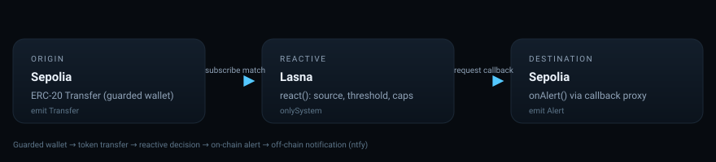

# Sentry · On-chain Wallet Alerting

Sentry watches ERC-20 outflows from a guarded wallet. When a transfer exceeds the configured
threshold, a reactive contract triggers a cross-chain callback that records an alert on the
destination chain, and a notifier pushes the alert to the operator.

It runs without a server and without a hosted private key.



- Live view: https://artistlogic.github.io/guardian/
- Repository: https://github.com/artistlogic/guardian
- Callback contract (Sepolia): [`0xa070a801…abe0`](https://eth-sepolia.blockscout.com/address/0xa070a801f8cd3f844e41e672d9e42380485cabe0)

## 1. What it does

A wallet sends a token transfer. Sentry checks whether that transfer came from the guarded address
and whether it exceeds a threshold. If both hold, it writes an alert on the destination chain and
pushes a notification. Everything is visible on-chain.

| Sentry does | Sentry does not |
|---|---|
| detect outflows above a threshold | stop or revert a transfer |
| record an alert on a destination chain | move or custody funds |
| push a notification to the operator | replace multisig or approval workflows |

The tool exists because the common alternatives each have a gap: watching an explorer by hand is
not sustainable; a self-hosted keeper needs a server and a hosted key; paid monitoring services are
priced opaquely; wallet built-in controls follow vendor rules rather than the user's.

## 2. Evidence

| Step | Transaction |
|---|---|
| Origin transfer (10 D3RT, Sepolia) | https://eth-sepolia.blockscout.com/tx/0x632fb41ed499697eef05a0b5638984dd8161dc4f1a3cf1422c6fe1fad2d8494c |
| `react()` on Lasna | https://lasna.reactscan.net/tx/0x01960122654318f025145e87230d469243b9eb387cc3076f6c55a742720500c5 |
| Callback `Alert` on Sepolia | https://eth-sepolia.blockscout.com/tx/0x3d673287f16d7a4e63526053c4061905360fe904ec615fca1d07fa343b7ce926 |
| Below-threshold transfer (1 D3RT) | https://eth-sepolia.blockscout.com/tx/0x99713085eab4f09c6e65980e0e8c97fb13125fa0e0ab52d3feb94f13f27931f4 |

The below-threshold transfer produced no alert: `alerts` stayed at 0 before the positive run.

| Contract | Chain | Address |
|---|---|---|
| GuardianReactive | Lasna (5318007) | `0xd9cda08baac9de9cbe658e553a8fd7112c7f7034` |
| GuardianCallback | Sepolia (11155111) | `0xa070a801f8cd3f844e41e672d9e42380485cabe0` |
| Watched token (D3RT) | Sepolia | `0x259d2fb64231d85e639d1074fa724bcdf29a4ed9` |

Readings after the runs: `alerts = 1`, `totalValue = 10e18`, `count = 1`.

```text
guarded wallet          Sepolia            Lasna                 Sepolia
     │ transfer 10 D3RT     │                  │                     │
     ├─────────────────────▶│ Transfer         │                     │
     │                      │ ──event─────────▶│ react()             │
     │                      │                  │ threshold, caps     │
     │                      │                  ├──callback──────────▶│ onAlert()
     │                      │                  │                     │ emit Alert
```

## 3. How it works

The subscription is narrowed at the network level: `chainId + token + topic0 + topic1(guarded wallet)`.
Only transfers from the guarded wallet reach `react()`.

`react()` applies the business rules in order: source contract, log type, pause state, remaining
alert quota, duplicates by source transaction hash, then the amount threshold and caps. Conditions
that fail return silently; reverting would still consume the fee.

A qualifying transfer requests a callback through the system contract. The payload carries the
callback selector and the alert data; the first argument is injected by the callback proxy with the
address of the reactive contract, so the receiver can verify the sender.

The callback function is guarded twice: `onlyServiceProvider` accepts only the callback proxy, and
`onlyCallbackSender` accepts only the authorized reactive contract.

Amount and subscription limits:

- per-alert value cap, and a total value cap after which the contract unsubscribes
- an alert count limit, after which the contract unsubscribes
- an owner-only `pause()`
- an owner-only `setThreshold()`, so the threshold can be changed without redeploying

## 4. Run it

```bash
forge build
forge test -vv
```

Deploy on testnets:

```bash
cp .env.example .env      # fill in PRIVATE_KEY and addresses
source .env && bash script/deploy.sh
```

The script deploys the reactive contract on Lasna (pre-funded), the callback contract on the
destination chain (pre-funded), and binds the recipient. It prints both addresses.

Trigger one run:

```bash
cast send "$TOKEN" "transfer(address,uint256)" 0x000000000000000000000000000000000000dEaD 10000000000000000000 \
  --rpc-url "$SEPOLIA_RPC_URL" --private-key "$PRIVATE_KEY"
```

## 5. Verify

```bash
# reactive side
cast call <REACTIVE> "alerts()(uint256)"     --rpc-url https://lasna-rpc.rnk.dev/
cast call <REACTIVE> "totalValue()(uint256)" --rpc-url https://lasna-rpc.rnk.dev/

# destination side
cast call <CALLBACK> "count()(uint256)" --rpc-url https://ethereum-sepolia-rpc.publicnode.com

# events
cast logs --rpc-url https://lasna-rpc.rnk.dev/ --address <REACTIVE> "Alerted(uint256,uint256,uint256)"
cast logs --rpc-url https://ethereum-sepolia-rpc.publicnode.com --address <CALLBACK> "Alert(address,uint256,uint256,uint256,uint256)"
```

## 6. Tests

```bash
forge test -vv
# 13 passed
```

| Test | Verifies |
|---|---|
| `test_CountsOnce` | a transfer above the threshold is processed once |
| `test_BelowThresholdIgnored` | below-threshold transfers are ignored |
| `test_OnlySystem` | calls outside the system contract revert |
| `test_DuplicateIgnored` | the same source transaction is processed once |
| `test_PerAlertCap` | per-alert value is capped |
| `test_TotalCapStops` | processing stops at the total cap |
| `test_PauseStops` | paused contracts do not process |
| `test_ThresholdConfigurable` | the owner can change the threshold |
| `test_SetThresholdOnlyOwner` | non-owners cannot change it |
| `test_OnAlertHappyPath` | the proxy can deliver an alert |
| `test_OnAlertRejectsNonProxy` | direct calls are rejected |
| `test_OnAlertRejectsWrongSender` | only the authorized contract is accepted |
| `test_OnAlertAccumulates` | alerts accumulate |

## 7. Failure modes

| Failure | What happens | Recovery |
|---|---|---|
| Reactive contract runs out of funds | `debt > 0`; execution stops with no error | `depositTo()` clears the debt |
| Callback fails | the proxy charges the attempt and emits `CallbackFailure`; `count` does not change | check `gasLimit`, target contract and funding, then trigger again |
| Duplicate events | rejected by `seen[txHash]` | none needed |
| Noise events | filtered by subscription and threshold | adjust the threshold |
| Value above caps | capped or stopped, then unsubscribed | redeploy with different limits |
| Forged callback | rejected by both guards | none needed |

Recovery from debt:

```bash
cast call 0x8888888888888888888888888888888888888888 "debt(address)(uint256)" <contract>
cast send 0x8888888888888888888888888888888888888888 "depositTo(address)" <contract> --value 1ether
cast call <contract> "alerts()(uint256)"
```

## 8. Scope and roadmap

This version records alerts. It does not move funds.

The next pieces are separate and opt-in:

1. A response action behind a user-approved allowance and a higher action threshold.
2. Allowlist rules: transfers outside a user-supplied allowlist are classified as higher severity.
3. Human-in-the-loop above a hard cap.

These need a second contract to hold an allowance, which is a different trust decision from
alerting. Alerting alone has no such requirement, which is why it ships first.

Integration surfaces (config file, webhook, SDK): [docs/INTEGRATION.md](docs/INTEGRATION.md).

## 9. AI assistance

Parts drafted with AI assistance, reviewed and tested before use:

| Part | AI involvement | Verification |
|---|---|---|
| Contract skeleton and comments | drafted, reviewed line by line | `forge build`, `forge test` (13 tests), on-chain runs |
| Tests | drafted | `forge test -vv` passes; each case checked against contract behavior |
| README | drafted | every command executed manually on testnets |
| Evidence in §2 | produced by real transactions | read back with `cast` and block explorers |

All addresses and hashes in §2 come from actual deployments and transfers.

## 10. Notes

- Testnets only: Sepolia for the origin and destination chains, Lasna for the reactive contract.
- `.env` is not committed.
- The notifier is an off-chain script; it is not part of the contracts.
