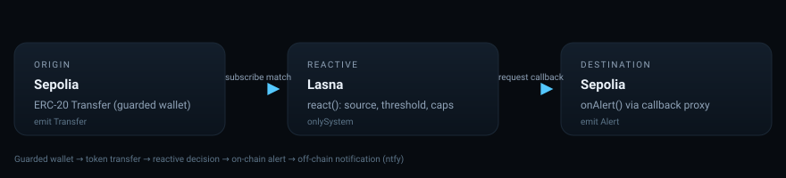

# Sentry · 链上钱包哨兵

> **监听指定钱包的 ERC-20 转出事件。单笔金额超过阈值时，由 Reactive 在目标链上自动执行告警——
> 不需要自建服务器，也不需要托管私钥。**
>
> **定位**：基于 Reactive Omni 的轻量级跨链告警中间件——只负责发现、记录、通知，
> 不拦截交易、不触碰资金。
>
> [English README](README.md)

## 1. 它是什么

```text
 Sepolia（源链）                  Lasna（Reactive）                  Sepolia（目标链）
 ────────────────                ─────────────────                  ──────────────────
 ERC-20 Transfer                 GuardianReactive.react()            GuardianCallback.onAlert()
 from = 被守护钱包      ──▶      value ≥ 阈值 ?                      emit Alert(value, originTxHash)
 value ≥ 阈值                    requestCallbackV_1_0   ─────────▶
```

核心价值：**告警由网络在链上完成，而不是你托管的机器人。**



**10 秒速览：** [实时看板](https://artistlogic.github.io/guardian/) ·
[源交易](https://eth-sepolia.blockscout.com/tx/0x632fb41ed499697eef05a0b5638984dd8161dc4f1a3cf1422c6fe1fad2d8494c) ·
[回调交易](https://eth-sepolia.blockscout.com/tx/0x3d673287f16d7a4e63526053c4061905360fe904ec615fca1d07fa343b7ce926)

### 解决的问题

自托管钱包越来越多，但异常转出常发生在没人看屏幕的时候（深夜、出差、开会）。现有方案都有短板：

| 方案 | 问题 |
|---|---|
| 人工盯区块浏览器 | 不可持续，注意力成本高 |
| 自建 Keeper 脚本 + 云服务器 | 要长期运维，私钥托管有风险 |
| 付费监控服务 | 单价不透明，个人用户留存差 |
| 钱包内置风控 | 规则由厂商定，不可自定义 |

Reactive 把"监听 + 可靠发交易"交给网络，用户只需要定义"什么算异常、异常时做什么"。

## 2. 演示证据

| 步骤 | 交易 |
|---|---|
| ① 源链事件（D3RT `Transfer` 10 枚，Sepolia） | https://eth-sepolia.blockscout.com/tx/0x4fe9d51fb6c57e86852e61fac842e98901788b7949bafb918019cd1f3cb326ee |
| ② Reactive `react()`（Lasna） | https://lasna.reactscan.net/tx/0x01960122654318f025145e87230d469243b9eb387cc3076f6c55a742720500c5 |
| ③ 目标链回调（`Alert`，Sepolia） | https://eth-sepolia.blockscout.com/tx/0xe439ee83286ecc1222173317aadd28e6c104f4a5e9606106e8112e8ae3715371 |
| 负例（1 D3RT，低于阈值，不触发） | https://eth-sepolia.blockscout.com/tx/0x99713085eab4f09c6e65980e0e8c97fb13125fa0e0ab52d3feb94f13f27931f4 |

**已部署合约**

| 合约 | 链 | 地址 |
|---|---|---|
| GuardianReactive | Lasna (5318007) | `0xd9cda08baac9de9cbe658e553a8fd7112c7f7034` |
| GuardianCallback | Sepolia (11155111) | `0xa070a801f8cd3f844e41e672d9e42380485cabe0` |
| 被监控代币（D3RT） | Sepolia | `0x259d2fb64231d85e639d1074fa724bcdf29a4ed9` |

**运行后读数**：`alerts = 1`、`totalValue = 10e18`、`count = 1`；
负例运行后 `alerts` 保持为 0。

> 测试网迭代过程中部署过多个版本，旧版本已 `pause()` 退订（链上可见），上表为当前版本。

## 3. 工作原理

- **订阅收窄**：`chainId + 代币地址 + topic0 + topic1(被守护钱包)`，只有"从该钱包转出"的转账会进入 `react()`。
- **阈值判断**：`react()` 内判断，低于阈值直接 `return`（不 revert，回滚也要收费）。
- **回调内容**：`(reactive, originChainId, originTxHash, value, alertIndex)`，第一个参数由代理注入。
- **两道门锁**：`onlyServiceProvider`（只认回调代理）+ `onlyCallbackSender`（只认本项目授权的 reactive 合约）。
- **防失控**：
  - 订阅过滤 + 合约内校验，只在该触发时触发；
  - `seen[txHash]` 去重，同一笔源交易只处理一次；
  - 单笔金额封顶 + 累计封顶；`maxAlerts` 到顶自动退订；owner 可 `pause()`。

## 3b. 现在真的能跑的部分

**测试网上真实可点（见第 2 节）：**

- 源链转账 → `react()` → 目标链 `Alert`，三笔交易均可验证
- 低于阈值的转账被忽略（第 2 节负例）
- 订阅过滤 `topic1 = 被守护钱包`；阈值、去重、单笔与累计上限
- 13 个 Foundry 测试（`forge test -vv`），每次 push 自动跑 CI
- 链下通知器把每条 `Alert` 推送到 ntfy 频道（网页/App 可看）

**仅用于演示的部分：**

- 视频里的转账金额与时机是为录制挑选的；链上交易是真实的
- 通知器演示时跑在笔记本上（生产环境应作为常驻服务）

## 3c. 踩过的坑（Hacky parts）

- **回调 payload 必须带 4 字节函数选择器**：只用 `abi.encode(...)` 会导致目标合约无法分发，
  react 交易成功但回调静默失败。
- **合约变大后 `eth_estimateGas` 会失败**：部署时显式传 `--gas-limit`，并先给钱包充值。
- **Reactive 合约不会"自动废弃"**：不退订就一直收事件、一直扣费；旧版本用 `pause()` 停掉（链上可见）。
- **余额用尽会静默停服**（`debt > 0` 不报错，只是不再执行），恢复流程写在 5b 节。
- **网络选择比代码更折腾**：公共 RPC 时通时断；Telegram API 在当前网络不可达，通知改用 ntfy。

## 4. 怎么跑

### 编译与测试

```bash
forge build
forge test -vv
```

### 部署（测试网）

```bash
cp .env.example .env      # 填 PRIVATE_KEY、代币、被守护钱包、代理地址
source .env && bash script/deploy.sh
```

脚本会在 Lasna 部署 `GuardianReactive`（预充值）、在目标链部署 `GuardianCallback`（预充值），
并绑定收件地址，最后打印两个合约地址。

### 触发一次

从被守护钱包发一笔超过阈值的测试代币转账：

```bash
cast send "$TOKEN" "transfer(address,uint256)" 0x000000000000000000000000000000000000dEaD 10000000000000000000 \
  --rpc-url "$SEPOLIA_RPC_URL" --private-key "$PRIVATE_KEY"
```

约 30–120 秒后 `react()` 触发、回调落到目标链。

## 5. 边界（不解决什么）

- 只能**发现并记录**，已经转出的资产无法撤销；
- 本版本不自动转移资产（需要预授权额度，属于另一层设计）；
- 企业级控制（多签、白名单、审批流、合规筛查）不在范围内。

## 5b. 出问题怎么办

| 出问题 | 会发生什么 | 怎么处理 |
|---|---|---|
| **Reactive 合约余额用完** | `debt > 0` → 系统**静默停服**（不报错，只是不动了） | `depositTo(合约)` 充值清零 debt，并持续监控 |
| **目标链回调失败** | 代理照常收费并发 `CallbackFailure`，`count` 不增加 | 查目标合约 / `gasLimit` / 回调合约余额，处理后重新触发 |
| **重复事件** | `seen[txHash]` 拦下 | 无需处理 |
| **误触发** | 订阅过滤 + 阈值拦截 | 调整阈值 |
| **金额过大** | 单笔封顶、累计到顶停止并退订 | 重新部署调整上限 |
| **伪造回调** | 两道门锁拒绝 | 无需处理 |

```bash
# 欠费恢复三步
cast call 0x8888888888888888888888888888888888888888 "debt(address)(uint256)" <合约>
cast send 0x8888888888888888888888888888888888888888 "depositTo(address)" <合约> --value 1ether
cast call <合约> "alerts()(uint256)"
```

## 6. 测试

```bash
forge test -vv   # 13 passed
```

| 测试 | 验证 |
|---|---|
| `test_CountsOnce` | 正常路径，执行一次 |
| `test_DuplicateIgnored` | 同一 txHash 只处理一次 |
| `test_BelowThresholdIgnored` | 低于阈值忽略 |
| `test_OnlySystem` | 非系统调用 revert |
| `test_PerAlertCap` | 单笔封顶 |
| `test_TotalCapStops` | 累计到顶停止 |
| `test_PauseStops` | 暂停后不再处理 |
| `test_ThresholdConfigurable` | owner 可修改阈值 |
| `test_SetThresholdOnlyOwner` | 非 owner 不能修改 |
| `test_OnAlertHappyPath` | 代理投递回调正常计数 |
| `test_OnAlertRejectsNonProxy` | 非代理直接调用被拒 |
| `test_OnAlertRejectsWrongSender` | 只接受授权 reactive |
| `test_OnAlertAccumulates` | 多次回调累计 |

## 7. 链上验证

```bash
# Reactive 侧：react() 跑了吗？
cast call <GUARDIAN_REACTIVE> "alerts()(uint256)"     --rpc-url https://lasna-rpc.rnk.dev/
cast call <GUARDIAN_REACTIVE> "totalValue()(uint256)" --rpc-url https://lasna-rpc.rnk.dev/

# 目标链侧：回调落了吗？
cast call <GUARDIAN_CALLBACK> "count()(uint256)" --rpc-url https://ethereum-sepolia-rpc.publicnode.com

# 事件
cast logs --rpc-url https://lasna-rpc.rnk.dev/ --address <GUARDIAN_REACTIVE> "Alerted(uint256,uint256,uint256)"
cast logs --rpc-url https://ethereum-sepolia-rpc.publicnode.com --address <GUARDIAN_CALLBACK> "Alert(address,uint256,uint256,uint256,uint256)"
```

第 2 节的交易即预期终态：源链转账 → Lasna 上 `react()` → 目标链 `Alert`。

## 8. AI 使用说明

以下部分使用了 AI 辅助起草（Claude/DeepSeek），并逐项验证：

| 部分 | AI 参与 | 验证方式 |
|---|---|---|
| 合约骨架与注释 | AI 起草，人工逐行审阅 | `forge build` + `forge test`（13 项）+ 链上实际运行 |
| 测试 | AI 起草 | `forge test -vv` 全绿；逐条对照合约行为复核 |
| README 结构 | AI 起草 | 所有命令均手工在测试网执行过 |
| 第 2 节链上证据 | 真实交易产生 | 用 `cast` 与区块浏览器独立核对 |

第 2 节所有地址与交易哈希均来自真实部署与执行，没有模拟数据。

## 9. 安全说明

仅使用测试网（Sepolia / Lasna）。永远不要提交 `.env`。
